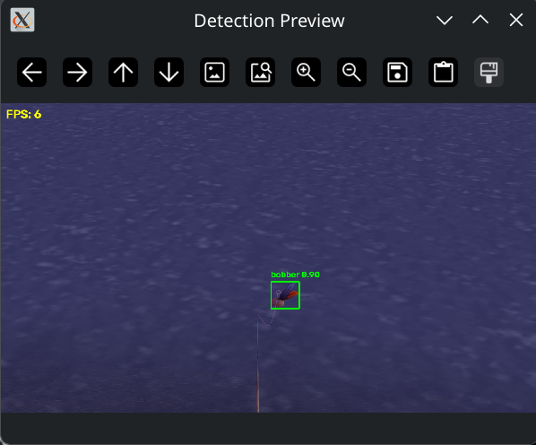
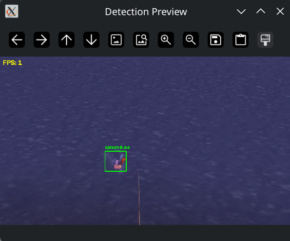

# WoW AI Fishing Assistant

An AI-powered fishing automation bot for **World of Warcraft**, written in modern C++ using computer vision, ONNX object detection, and automated mouse and keyboard input.

The project uses a computer vision pipeline to analyze captured game frames, detect fishing-related objects, and execute fishing actions based on their positions and the current state of the fishing process.

## Screenshots

|  |  |
| :---: | :---: |


## Disclaimer

**This project is intended for educational and research purposes only.**

It was developed to demonstrate the practical application of artificial intelligence, computer vision, neural networks, and automation using modern C++.

- **No warranty:** This software is provided "as is", without any express or implied warranties.
- **Limitation of liability:** The author assumes no responsibility or liability for any damages, losses, account restrictions, bans, or other consequences arising from the use or misuse of this software, to the extent permitted by applicable law.
- **User responsibility:** Users are solely responsible for how they use this software and for ensuring that their activities comply with the applicable game rules, terms of service, and relevant laws.
- **No guarantee of compatibility:** Game updates, changes to detection models, and changes to the operating environment may affect the software's functionality.

By using this software, you acknowledge that you do so at your own risk.

## How to Use

1. **Launch the application** — Start the program and make sure World of Warcraft is running.
2. **Configure the settings** — Specify the required configuration.
3. **Select the capture region** — Choose the area of the screen where the fishing bobber will appear.
4. **Start fishing** — Activate the bot using the configured hotkey.
5. **Wait for detection** — The AI model analyzes captured frames and detects the fishing bobber and splash effects.
6. **Automatic interaction** — When a fishing event is detected, the application performs the configured input actions to reel in the catch.
7. **Monitor the process** — Use the preview window and application logs to check detection results and troubleshoot issues.
8. **Stop the bot** — Use the configured stop hotkey or close the application.

### Important Notes

- Make sure the game window and fishing area are visible to the screen capture system; using "windowed (fullscreen)" (borderless windowed) mode is recommended.
- **Detection accuracy:** Detection performance depends on the model, screen resolution, lighting, and capture region. For better detection of fishing splash effects, it is recommended to set **Particle Density** to the maximum in the World of Warcraft graphics settings.
- Hotkeys and configuration options may vary depending on the application settings.
- Use the software at your own risk and ensure your use complies with the game's rules and terms of service.

## Features

- **AI-powered object detection** — Detects fishing bobbers and water splashes using an ONNX object detection model (based on YOLO v26).
- **Real-time screen capture** — Captures a configurable region of the screen for efficient image processing.
- **Computer vision** — Uses OpenCV to preprocess images, run inference, and decode model predictions.
- **Multiple inference backends** — Supports CPU, OpenCL, and CUDA backends, depending on the OpenCV build and available hardware.
- **Automated fishing actions** — Casts the fishing line, monitors the bobber, detects splashes, and performs mouse actions at detected splash locations.
- **Configurable capture region** — Allows selecting the screen region used for detection.
- **Hotkey controls** — Start and stop fishing, reconfigure the capture region, or exit the application using configurable keyboard shortcuts.
- **Detection preview** — Optionally displays detected objects, confidence scores, and FPS.

## AI Model

This project is based on a **pre-trained YOLO v26 neural network** for object detection, adapted for recognizing fishing-related objects in World of Warcraft.

The model is used to detect fishing bobbers and splash effects from captured game frames. Its predictions are processed by the OpenCV DNN pipeline and passed to the fishing automation state machine.

## How It Works

The bot follows a continuous perception-and-action pipeline while fishing is enabled.

1. **Capture:** Capture the configured screen region.
2. **Preprocess:** Resize the image while preserving its aspect ratio, apply letterboxing, convert BGR to RGB, and normalize pixel values.
3. **Inference:** Run the ONNX model using the configured OpenCV DNN backend.
4. **Detection:** Decode model predictions, filter low-confidence results, map bounding boxes back to screen coordinates, and apply non-maximum suppression when necessary.
5. **Interpretation:** Identify fishing bobbers and splash effects using their configured class IDs.
6. **Action:** Cast the fishing line, wait for the bobber, and respond to detected splashes.
7. **Repeat:** Continue processing frames until fishing is stopped or the application exits.

## Architecture

The application is organized into several components with distinct responsibilities.

| Component | Responsibility |
|---|---|
| `Detector` | Loads the ONNX model, preprocesses images, performs inference, and returns object detections. |
| `FishingAction` | Implements the fishing state machine and coordinates casting, splash detection, and mouse actions. |
| `ScreenCapture` | Captures the screen or a selected screen region. |
| `Controller` | Provides mouse and keyboard input operations. |
| `HotkeyListener` | Handles start, stop, region selection, and quit commands. |
| `RobotContext` | Initializes and manages the underlying `robot-cpp` interaction context. |
| `AppConfig` | Provides application settings for the model, capture, display, hotkeys, and fishing behavior. |
| `RegionSelector` | Allows the user to configure the capture region interactively. |

### Fishing State Machine

The fishing logic is implemented as a state machine:

- **`ReadyToCast`** — Casts the line when no existing bobber or splash is detected.
- **`WaitingForBobber`** — Waits for the fishing bobber to appear or a splash to be detected.
- **`WaitingForSplash`** — Monitors the bobber and waits for a splash event.
- **`WaitingForNextCast`** — Enforces a cooldown before the next fishing attempt.

Timeouts and cooldowns help prevent the bot from waiting indefinitely for an expected visual event.

## Requirements

Before building the project, ensure the following dependencies are available:

- A C++ compiler with support for the C++23 language features used by the project.
- CMake and a build system compatible with the project's C++ module configuration.
- OpenCV with the required modules:
  - `core`
  - `imgproc`
  - `highgui`
  - `dnn`
- A supported operating system and graphics environment.
- Optional: compatible OpenCL or CUDA hardware and an OpenCV build configured for the desired backend.

**Note:** Exact compiler, CMake, OpenCV, and `robot-cpp` versions depend on the project's build configuration and the selected platform.

## Installation

### 1. Clone the Repository

```bash
git clone https://github.com/dimonp/fishing-assistant.git
cd assistant
```

### 2. Install Dependencies

Install a compatible C++ toolchain and OpenCV library.

Make sure the OpenCV installation includes the DNN module and any optional acceleration backends you intend to use.

### 3. Configure the Project

Configure the project using its CMake configuration:

```bash
cmake -S . -B build
```

### 4. Build

```bash
cmake --build build --config Release
```

The commands above assume the repository contains a compatible `CMakeLists.txt` and that its dependencies are discoverable by CMake.

## Configuration

The application loads its settings from `config.yaml` in the working directory.

The configuration covers the following areas:

| Section | Purpose |
|---|---|
| `model` | ONNX model path, input size, confidence threshold, class names, and inference backend. |
| `capture` | Monitor selection, capture coordinates, region dimensions, and FPS limit. |
| `fishing` | Splash and bobber timeouts, casting cooldown, and optional cast key. |
| `hotkeys` | Keyboard shortcuts for controlling the bot. |
| `display` | Preview window, confidence labels, FPS display, and window name. |

The exact YAML keys and defaults should match the project's configuration parser.

### Example Configuration

The following is an illustrative configuration template. Adapt the key names and values to match your `AppConfig` implementation.

```yaml
model:
  path: "models/fishing.onnx"
  input_size: 640
  confidence_threshold: 0.45
  backend: "opencl"
  classes:
    - "bobber"
    - "splash"

capture:
  fps_limit: 30
  monitor_index: 0
  region:
    x: 640
    y: 0
    width: 640
    height: 540

fishing:
  splash_timeout_ms: 10000
  bobber_timeout_ms: 15000
  cast_cooldown_ms: 2000
  cast_key: "F10"

hotkeys:
  start_fishing: "F6"
  stop_fishing: "F7"
  configure_region: "F8"
  quit: "ESC"

display:
  show_preview: true
  show_confidence: true
  show_fps: true
  window_name: "WoW AI Fishing Bot"
```

## License

This project is licensed under the GNU General Public License v3.0 (GPL-3.0).
You may use, modify, and redistribute this software under the terms of the license.
See the [LICENSE](LICENSE) file for the full license text.
Third-party libraries and dependencies may be distributed under their own licenses.
